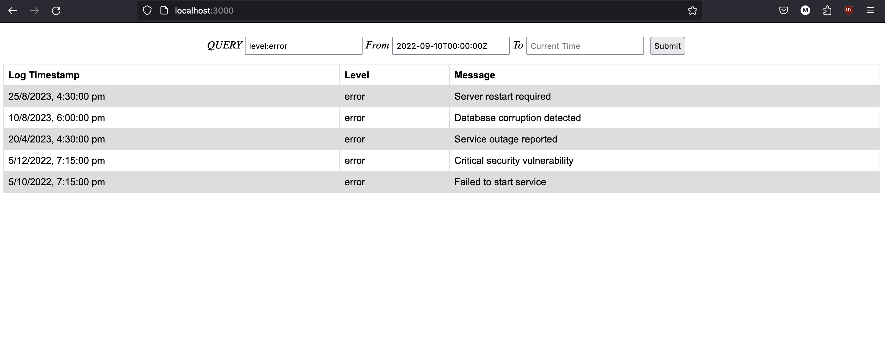

<h1 align="center">Log Ingester</h1>

A service for storing and searching logs. You send logs to it over HTTP, it saves them in MongoDB, and you can search them with a simple Lucene-style query language, either through the API or a small web page.



## What it does

- **Ingests logs in batches.** When many requests arrive at once, their logs are written to MongoDB together in one `insertMany` call instead of one insert each. In my local tests this roughly doubled write throughput.
- **Parses search queries.** A small parser handles `AND`, `OR`, `NOT`, brackets, quoted values, prefix wildcards (`abc*`), timestamp ranges and free-text search. Only known fields can be searched, so queries like `$where:...` are rejected.
- **Pages through results with a cursor.** Each searchable field has an index that also includes the timestamp, so results come back already sorted and only one page is read at a time.
- **Runs as 3 instances behind Caddy.** Caddy spreads requests across them and stops sending traffic to an instance that goes down.
- **Has tests** for the parser, validation, pagination and concurrent writes (`npm test`).

## Architecture

```
                 ┌──────────────────────────────┐
  clients ──────▶│ Caddy :3000                  │
  web UI         │ round robin, health checks   │
                 └──────┬─────────┬─────────┬───┘
                        ▼         ▼         ▼
                     :8001     :8002     :8003     Node.js / Express (stateless)
                        │  validate → batch writer (group commit)
                        │  query parser → MongoDB filter
                        └─────────┬─────────┘
                                  ▼
                               MongoDB   compound indexes + text index on message
```

| Path | What it does |
|---|---|
| `src/query/parser.js` | Tokenizer and recursive-descent parser that turns a query string into an AST |
| `src/query/compile.js` | Turns the AST into a MongoDB filter and enforces the field allowlist |
| `src/ingest/batchWriter.js` | Group-commit writer: up to 4 `insertMany` calls in flight, and batches build up while they run |
| `src/validation/log.js` | Validates each log and strips unknown fields |
| `src/routes/logs.js` | Ingest and search endpoints, cursor pagination |
| `src/models/log.models.js` | Schema and indexes |

## Getting started

Requirements: Node.js 18+ and [Caddy](https://caddyserver.com/docs/install) (`brew install caddy`). You don't need MongoDB installed, because `make mongo` starts a throwaway local one.

```sh
npm install
make mongo   # terminal 1: local MongoDB on :27017 (keep it running)
make run     # terminal 2: 3 instances + Caddy on :3000
```

Open the log explorer at http://localhost:3000/explorer/ and stop everything with `make stop`.

By default the app connects to `mongodb://127.0.0.1:27017/logs`. To use another database, set `MONGODB_URI` or copy `.env.example` to `.env`.

To run a single instance without Caddy: `npm start` (port 3000).

| Env var | Default | Meaning |
|---|---|---|
| `MONGODB_URI` | `mongodb://127.0.0.1:27017/logs` | MongoDB connection string |
| `PORT` | 3000 | HTTP port |
| `BATCH_SIZE` | 1000 | Max logs per `insertMany` |
| `MAX_IN_FLIGHT` | 4 | Max concurrent `insertMany` calls per instance |

Run the tests with `npm test`, and the load test against a running service with `npm run loadtest`.

## API

### Ingest: `POST /logs` (or `POST /`)

Send one log object, or an array of up to 1,000 logs.

```json
{
  "level": "error",
  "message": "Failed to connect to DB",
  "resourceId": "server-1234",
  "timestamp": "2023-09-15T08:00:00Z",
  "traceId": "abc-xyz-123",
  "spanId": "span-456",
  "commit": "5e5342f",
  "metadata": { "parentResourceId": "server-0987" }
}
```

`level` must be one of `fatal, error, warn, info, debug, trace`, and `message` is required. `timestamp` defaults to now. Invalid logs in a batch are reported by index and the valid ones are still stored:

```json
201 { "accepted": 2, "rejected": [{ "index": 1, "error": "level must be one of: ..." }] }
```

### Search: `GET /logs?q=<query>&from=<iso>&to=<iso>&limit=50&cursor=<cursor>`

Returns `{ "logs": [...], "nextCursor": "..." }`, newest first. To get the next page, pass `nextCursor` back as `cursor`. `limit` is at most 500. An invalid query returns `400` with a message explaining what's wrong.

### Health: `GET /health`

`200 {"status":"ok","db":"up"}`, or `503` if MongoDB is unreachable. Caddy uses this to take unhealthy instances out of rotation.

## Query language

| Query | Meaning |
|---|---|
| `level:error` | exact field match |
| `level:error resourceId:server-1` | `AND` is implicit |
| `level:error OR level:warn` | `OR` (`AND` binds tighter than `OR`) |
| `(level:error OR level:warn) AND commit:5e5342f` | grouping |
| `NOT level:info` | negation |
| `resourceId:"server 1"` | quoted value |
| `traceId:abc-*` | prefix match (uses the index) |
| `timestamp:>=2023-09-15T08:00:00Z` | comparison: `>`, `>=`, `<`, `<=` |
| `timestamp:[2023-09-15 TO 2023-09-16]` | inclusive range |
| `"connection refused" level:error` | free-text search in `message` |
| `metadata.parentResourceId:server-0987` | nested field |

Searchable fields: `level, message, resourceId, timestamp, traceId, spanId, commit, metadata.parentResourceId`.

Free-text terms use MongoDB's `$text` index, which only works at the top level, so they can be combined with `AND` but not with `OR` or `NOT`.

## Benchmarks

`npm run loadtest` uses [autocannon](https://github.com/mcollina/autocannon) with 100 connections for 15 s per scenario. These numbers come from an Apple M2 (8 cores) laptop with MongoDB running locally on the same machine, so treat them as relative, not absolute.

**Single instance: batch writer against one insert per request**

| Scenario | Group commit | One insert per request |
|---|---|---|
| Single-log POSTs | **9,462 logs/s**, p50 11 ms, p99 17 ms | 5,019 logs/s, p50 18 ms, p99 38 ms |
| 100-log batch POSTs | 32,700 logs/s | 30,434 logs/s |
| Search (`level:error AND resourceId:server-1*`) | 2,414 req/s, p50 40 ms | 2,035 req/s, p50 46 ms |

**3 instances behind Caddy**

| Scenario | Result |
|---|---|
| 100-log batch POSTs | **52,454 logs/s** (1.6× a single instance) |
| Single-log POSTs | 9,023 logs/s, the same as one instance, so MongoDB is the bottleneck here |
| Instance killed after 5 s of a 15 s test | 140,003 × 201, 5 × 502 |

**Query plans (`explain()` over 643k logs, first page of 50)**

| Query | Index used | Docs read | Time |
|---|---|---|---|
| `level:error` | `level_1_timestamp_-1__id_-1` | 51 | <1 ms |
| `traceId:trace-42` | `traceId_1_timestamp_-1__id_-1` | 51 | <1 ms |
| `level:error AND resourceId:server-1*` | `level_1_timestamp_-1__id_-1` | 258 | 3 ms |

## Limitations and next steps

- **Free-text search on common words is slow.** It scans the text index and sorts in memory (about 260 ms when a word matches all 380k logs). At scale, search belongs in Elasticsearch/OpenSearch, with MongoDB as the store.
- **The ingest path is synchronous.** A 201 means the logs are in MongoDB. Putting a queue (Kafka/Redis Streams) in front would absorb spikes and make the API faster, at the cost of eventual consistency.
- **No retention policy.** A TTL index on `timestamp` or time-based collections would cap storage.
- **Single MongoDB node.** Sharding on `(resourceId, timestamp)` would scale writes.
